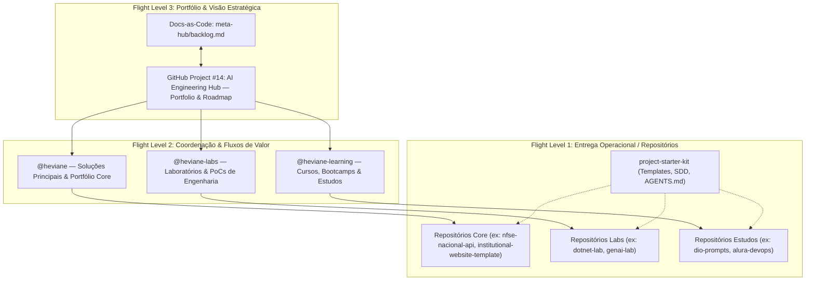
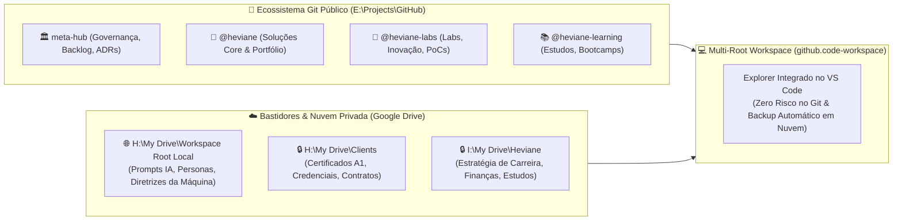

# Meta-Hub — Governança & Portfólio de Engenharia de Software

> **Central de Governança Ágil, Docs-as-Code e Coordenação de Portfólio**  
> Repositório: [`heviane/heviane`](https://github.com/heviane/heviane) &bull; Diretório: `meta-hub`  
> Responsável: [Heviane Bastos](https://github.com/heviane)

---

## 🎯 Visão Geral

O **Meta-Hub** é o núcleo de governança de projetos, padronização técnica e gestão de portfólio de todo o ecossistema GitHub (`@heviane`, `@heviane-labs` e `@heviane-learning`).

Ele adota os pilares da moderna engenharia de software:

- **Docs-as-Code:** Toda a estratégia, backlogs, inventários técnicos e decisões arquiteturais são versionados no Git.
- **Flight Levels & Gestão Ágil:** Separação clara entre visão estratégica de portfólio, coordenação operacional e entrega técnica nos repositórios.
- **AI-Assisted Software Engineering:** Desenvolvimento orientado a especificações (**Spec-Driven Development — SDD**) com agentes de IA alinhados por diretrizes (`AGENTS.md`).

---

## 🏛️ Arquitetura de Governança (Flight Levels)

---

## 🌐 Topologia do Ecossistema: Git Público vs. Nuvem Privada (ADR-002)

Para aliar **código aberto de alto impacto** com **segurança fiscal e confidencialidade estrita**, o ecossistema opera em uma topologia híbrida de dois pilares complementares, unificados via Multi-Root Workspaces do VS Code ([`ADR-002`](./adrs/0002-segregacao-dados-sensiveis-multi-root-workspaces.md)):

| Camada | Armazenamento & Protocolo | Finalidade | Regra de Versionamento |
| :--- | :--- | :--- | :--- |
| **Governança Oficial & Código** | `E:\Projects\GitHub\` (Git / GitHub) | Soluções de software, templates reutilizáveis, backlog oficial, ADRs e especificações técnicas (SDD). | **100% Versionado no Git.** Proibido qualquer dado sensível ou certificado real (Regra 9 do `AGENTS.md`). |
| **Diretrizes Locais & Prompts** | `H:\My Drive\Workspace Root Local\` (Nuvem) | Prompts de assistentes de IA, personas, notas de análise preliminares e auditorias locais. | **Fora do Git.** Sincronização contínua e histórico de revisões via Google Drive corporativo. |
| **Cofre de Clientes & Segredos** | `H:\My Drive\Clients\` (Nuvem) | Certificados A1 (`.pfx`), senhas, acessos a servidores (BrasilCloud, Tomcat), contratos e payloads reais. | **Estritamente Fora do Git.** Segregação física por design contra vazamentos acidentais. |
| **Bastidores & Carreira** | `I:\My Drive\Heviane\` (Nuvem) | Planejamento de carreira, rascunhos de artigos antes de publicar e estudos estratégicos. | **Estritamente Privado.** Ambiente pessoal sincronizado. |

---

## 📂 Artefatos do Meta-Hub

| Artefato                                                | Finalidade                                                            | Status                     |
| :------------------------------------------------------ | :-------------------------------------------------------------------- | :------------------------- |
| **[`backlog.md`](./backlog.md)**                        | Backlog mestre de ideação e governança de tarefas (Docs-as-Code).     | `Ativo`                    |
| **[`vscode-extensions.md`](./vscode-extensions.md)**    | Inventário padronizado das extensões do ambiente de desenvolvimento.  | `Auditado (75 extensões)`  |
| **[ADRs (`adrs/`)](./adrs/)**                           | Registros formais de decisões de arquitetura e metodologias adotadas. | `Ativo (ADR-001, ADR-002)` |
| **[CI/CD Workflow (`.github/`)](../.github/workflows/)** | Pipeline de validação Markdown, links e sintaxe de scripts em CI.    | `Ativo (Docs CI)`          |

---

## 🔄 Fluxo de Trabalho (Workflow Operacional)

1. **Ideação & Refinamento (Docs-as-Code):**
   - Novas demandas, cursos ou ideias de repositórios nascem documentadas no `backlog.md`.
2. **Priorização no Quadro Central (Flight Level 3):**
   - Demandas ativas são cadastradas ou sincronizadas como Issues vinculadas ao projeto:
     👉 **[AI Engineering Hub — Portfolio & Roadmap (Project 14)](https://github.com/users/heviane/projects/14)**
3. **Criação de Repositórios Padronizados (Flight Level 1):**
   - Novos projetos utilizam como base o template oficial:
     👉 **[`heviane/project-starter-kit`](https://github.com/heviane/project-starter-kit)**
4. **Execução Assistida por IA (Spec-Driven Development):**
   - Cada repositório contém seu arquivo `AGENTS.md` e a pasta `.specs/`, garantindo que assistentes de IA (Copilot, Antigravity, Claude, etc.) sigam padrões estritos de arquitetura, testes e commits antes de submeter código.

---

## 🌐 Organizações e Escopos

- **[heviane](https://github.com/heviane):** Conta pessoal e soluções estruturadas de portfólio profissional.
- **[heviane-labs](https://github.com/heviane-labs):** Laboratório de experimentação técnica, engenharia reversa, provas de conceito (PoCs) e protótipos de IA.
- **[heviane-learning](https://github.com/heviane-learning):** Repositórios de bootcamps, trilhas acadêmicas, tutoriais e projetos de cursos (DIO, Alura, etc.).
