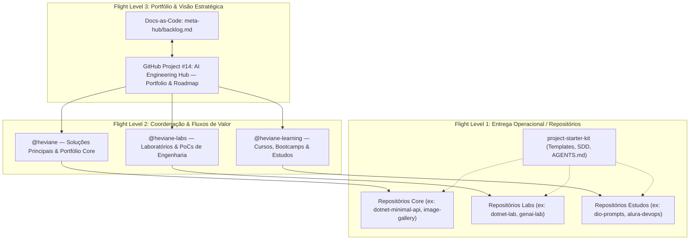

# Meta-Hub — Governança & Portfólio de Engenharia de Software

> **Central de Governança Ágil, Docs-as-Code e Coordenação de Portfólio**  
> Repositório: [`heviane/heviane`](https://github.com/heviane/heviane) &bull; Diretório: `meta-hub`  
> Responsável: [Heviane Bastos](https://github.com/heviane)

---

## 🎯 Visão Geral

O **Meta-Hub** é o núcleo de governança de projetos, padronização técnica e gestão de portfólio de todo o ecossistema GitHub (`@heviane`, `@heviane-labs` e `@heviane-learning`).

Ele adota os pilares da moderna engenharia de software:
- **Docs-as-Code:** Toda a estratégia, backlogs, inventários técnicos e decisões arquiteturais são versionados no Git.
- **Flight Levels & Gestão Ágil:** Separação clara entre visão estratégica de portfólio, coordenação operacional e entrega técnica nos repositórios.
- **AI-Assisted Software Engineering:** Desenvolvimento orientado a especificações (**Spec-Driven Development — SDD**) com agentes de IA alinhados por diretrizes (`AGENTS.md`).

---

## 🏛️ Arquitetura de Governança (Flight Levels)

---

## 📂 Artefatos do Meta-Hub

| Artefato | Finalidade | Status |
| :--- | :--- | :--- |
| **[`backlog.md`](./backlog.md)** | Backlog mestre de ideação e governança de tarefas (Docs-as-Code). | `Ativo` |
| **[`vscode-extensions.md`](./vscode-extensions.md)** | Inventário padronizado das extensões do ambiente de desenvolvimento. | `Auditado (74 extensões)` |
| **ADRs (`docs/adr/`)** | Registros formais de decisões de arquitetura e metodologias adotadas. | `Em Estruturação` |

---

## 🔄 Fluxo de Trabalho (Workflow Operacional)

1. **Ideação & Refinamento (Docs-as-Code):**
   * Novas demandas, cursos ou ideias de repositórios nascem documentadas no `backlog.md`.
2. **Priorização no Quadro Central (Flight Level 3):**
   * Demandas ativas são cadastradas ou sincronizadas como Issues vinculadas ao projeto:  
     👉 **[AI Engineering Hub — Portfolio & Roadmap (Project 14)](https://github.com/users/heviane/projects/14)**
3. **Criação de Repositórios Padronizados (Flight Level 1):**
   * Novos projetos utilizam como base o template oficial:  
     👉 **[`heviane/project-starter-kit`](https://github.com/heviane/project-starter-kit)**
4. **Execução Assistida por IA (Spec-Driven Development):**
   * Cada repositório contém seu arquivo `AGENTS.md` e a pasta `.specs/`, garantindo que assistentes de IA (Copilot, Antigravity, Claude, etc.) sigam padrões estritos de arquitetura, testes e commits antes de submeter código.

---

## 🌐 Organizações e Escopos

* **[heviane](https://github.com/heviane):** Conta pessoal e soluções estruturadas de portfólio profissional.
* **[heviane-labs](https://github.com/heviane-labs):** Laboratório de experimentação técnica, engenharia reversa, provas de conceito (PoCs) e protótipos de IA.
* **[heviane-learning](https://github.com/heviane-learning):** Repositórios de bootcamps, trilhas acadêmicas, tutoriais e projetos de cursos (DIO, Alura, etc.).

