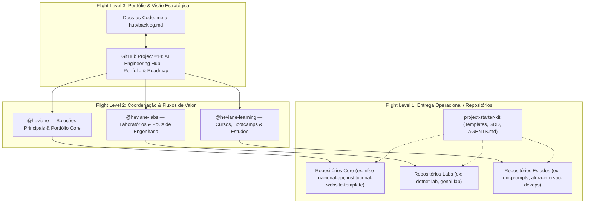
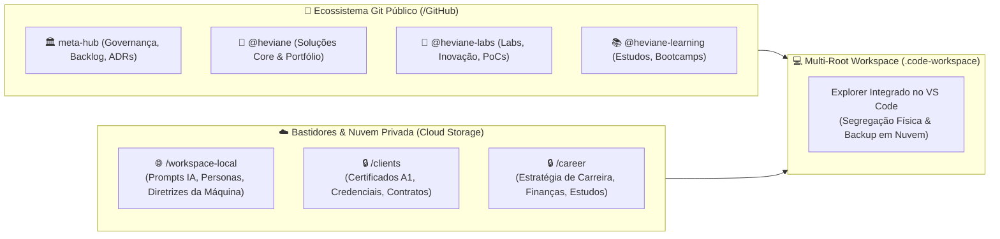

# Meta-Hub — Governança & Portfólio de Engenharia de Software

> **Central de Governança Ágil, Docs-as-Code e Coordenação de Portfólio**  
> Repositório: [`heviane/heviane`](https://github.com/heviane/heviane) &bull; Diretório: `meta-hub`  
> Responsável: [Heviane Bastos](https://github.com/heviane)

---

## 🎯 Visão Geral

O **Meta-Hub** é o núcleo de governança de projetos, padronização técnica e gestão de portfólio de todo o ecossistema GitHub (`@heviane`, `@heviane-labs` e `@heviane-learning`).

Ele adota os pilares da moderna engenharia de software:

- **Docs-as-Code:** Toda a estratégia, backlogs, inventários técnicos e decisões arquiteturais são versionados no Git.
- **Flight Levels & Gestão Ágil:** Separação clara entre visão estratégica de portfólio, coordenação operacional e entrega técnica nos repositórios.
- **AI-Assisted Software Engineering Platform (AI-SEP):** Ecossistema estruturado em camadas integrando governança, starter kit, Spec-Driven Development (SDD), contratos de IA (`AGENTS.md`) e automação contínua ([ADR-0003](./adrs/0003-ai-sep-platform-architecture.md)).

---

## 🩺 Matriz de Saúde e Integridade de Governança

Painel executivo de conformidade contínua dos artefatos e automações do ecossistema:

| Dimensão de Governança | Mecanismo de Verificação | Frequência / Gatilho | Status / Indicador |
| :--- | :--- | :--- | :---: |
| **Padronização Markdown** | `markdownlint-cli2` (sem erros em arquivos `.md`) | Push / PR / Semanal | `🟢 100% Conforme` |
| **Integridade de Links** | `Lychee Link Checker` (links internos e externos) | Push / PR / Semanal | `🟢 Verificado` |
| **Scanner de Segredos** | `Gitleaks Scanner` (detecção de chaves/tokens) | Push / PR / Semanal | `🟢 Zero Leaks` |
| **Automações PowerShell** | Testes Pester 3.4+ ([`meta-hub/tests`](./tests/README.md)) | Push / PR / Local | `🟢 22/22 Aprovados` |
| **Backlog & Roadmap** | Sincronização Docs-as-Code vs. GitHub Project 14 | Contínuo / HITL | `🟢 Sincronizado` |
| **Decisões Arquiteturais** | Rastreabilidade Formal de ADRs (001, 002 e 003) | Contínuo | `🟢 3 ADRs Vigentes` |
| **Catálogo de Repositórios** | Inventário & Matriz de Maturidade (SDD) dos 24 repositórios | Auditoria Periódica | `🟢 24 Repositórios Auditados` |
| **Dependências de CI** | GitHub Dependabot (`.github/dependabot.yml`) | Semanal | `🟢 Monitoramento Ativo` |

---

## 🏛️ Arquitetura de Governança (Flight Levels)

---

## 🌐 Topologia do Ecossistema: Git Público vs. Nuvem Privada (ADR-0002)

Para aliar **código aberto de alto impacto** com **segurança fiscal e confidencialidade estrita**, o ecossistema opera em uma topologia híbrida de dois pilares complementares, unificados via Multi-Root Workspaces do VS Code ([`ADR-0002`](./adrs/0002-sensitive-data-segregation-multi-root-workspaces.md)):

| Camada | Armazenamento & Protocolo | Finalidade | Regra de Versionamento |
| :--- | :--- | :--- | :--- |
| **Governança Oficial & Código** | `<workspace-root>/GitHub/` (Git / GitHub) | Soluções de software, templates reutilizáveis, backlog oficial, ADRs e especificações técnicas (SDD). | **100% Versionado no Git.** Proibido qualquer dado sensível ou certificado real (Regra 9 do `AGENTS.md`). |
| **Diretrizes Locais & Prompts** | `<governance-cloud>/workspace-local/` (Nuvem) | Prompts de assistentes de IA, personas, notas de análise preliminares e auditorias locais. | **Fora do Git.** Sincronização contínua e histórico de revisões via nuvem corporativa (Google Drive). |
| **Cofre de Clientes & Segredos** | `<secure-vault>/clients/` (Nuvem) | Certificados A1 (`.pfx`), senhas, acessos a servidores (servidores de aplicação e bancos de dados em nuvem), contratos e payloads reais. | **Estritamente Fora do Git.** Segregação física por design contra vazamentos acidentais. |
| **Bastidores & Carreira** | `<personal-vault>/career/` (Nuvem) | Planejamento de carreira, rascunhos de artigos antes de publicar e estudos estratégicos. | **Estritamente Privado.** Ambiente pessoal sincronizado. |

> 💡 *Nota de Portabilidade: Os caminhos acima utilizam referências conceituais (`<workspace-root>`, `<governance-cloud>`, `<secure-vault>`). Em cada estação de trabalho, eles são mapeados para seus respectivos pontos de montagem locais ou unidades de nuvem sincronizadas.*

---

## 📂 Artefatos do Meta-Hub

| Artefato                                                | Finalidade                                                            | Status                     |
| :------------------------------------------------------ | :-------------------------------------------------------------------- | :------------------------- |
| **[`backlog.md`](./backlog.md)**                        | Backlog mestre de ideação e governança de tarefas (Docs-as-Code).     | `Ativo`                    |
| **[`repository-catalog.md`](./repository-catalog.md)**  | Catálogo unificado e matriz de maturidade dos 24 repositórios públicos. | `Ativo (24 repos)`         |
| **[`vscode-extensions.md`](./vscode-extensions.md)**    | Inventário padronizado das extensões do ambiente de desenvolvimento.  | `Auditado (67 extensões)`  |
| **[`agents-catalog.md`](./agents-catalog.md)**          | Catálogo canônico e matriz de paridade de contratos de IA (`AGENTS.md`). | `Ativo (9 contratos)`      |
| **[ADRs (`adrs/`)](./adrs/README.md)**                  | Registros formais de decisões de arquitetura e metodologias adotadas. | `Ativo (ADR-0001, ADR-0002, ADR-0003)` |
| **[`maintenance-guide.md`](./maintenance-guide.md)**    | Guia de convenções de manutenção, commits semânticos e quality gates. | `Ativo`                    |
| **[Scripts (`scripts/`)](./scripts/)**                  | Automações de auditoria (`audit-workspace.ps1`) e sincronização (`sync-extensions.ps1`). | `Ativo` |
| **[CI/CD Workflow (`.github/`)](../.github/workflows/)** | Pipeline de validação Markdown, links e sintaxe de scripts em CI.    | `Ativo (Docs CI)`          |

---

## 🔄 Fluxo de Trabalho (Workflow Operacional)

1. **Ideação & Refinamento (Docs-as-Code):**
   - Novas demandas, cursos ou ideias de repositórios nascem documentadas no `backlog.md`.
2. **Priorização no Quadro Central (Flight Level 3):**
   - Demandas ativas são cadastradas ou sincronizadas como Issues vinculadas ao projeto:
     👉 **[AI Engineering Hub — Portfolio & Roadmap (Project 14)](https://github.com/users/heviane/projects/14)**
3. **Criação de Repositórios Padronizados (Flight Level 1):**
   - Novos projetos utilizam como base o template oficial:
     👉 **[`heviane/project-starter-kit`](https://github.com/heviane/project-starter-kit)**
4. **Execução Assistida por IA (Spec-Driven Development):**
   - Cada repositório contém seu arquivo `AGENTS.md` e a pasta `docs/specs/`, garantindo que assistentes de IA (Copilot, Antigravity, Claude, etc.) sigam padrões estritos de arquitetura, testes e commits antes de submeter código.

---

## 🌐 Organizações e Escopos

- **[heviane](https://github.com/heviane):** Conta pessoal e soluções estruturadas de portfólio profissional.
- **[heviane-labs](https://github.com/heviane-labs):** Laboratório de experimentação técnica, engenharia reversa, provas de conceito (PoCs) e protótipos de IA.
- **[heviane-learning](https://github.com/heviane-learning):** Repositórios de bootcamps, trilhas acadêmicas, tutoriais e projetos de cursos (DIO, Alura, etc.).
