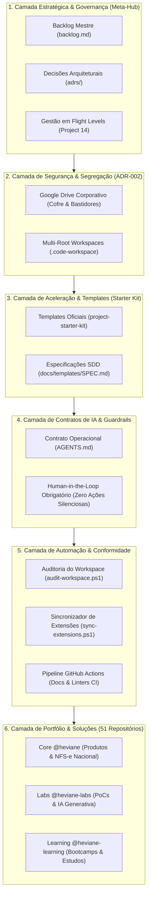

# ADR-003: Formalização da Plataforma de Engenharia de Software Assistida por IA (AI-SEP)

> **Status:** `Aprovado`  
> **Data:** 2026-11-21  
> **Decisores:** Heviane Bastos  
> **Contexto Técnico:** Formalização da *AI-Assisted Software Engineering Platform* (AI-SEP) como arquitetura proprietária unificada para governança, automação e desenvolvimento assistido por IA em ecossistema multi-repositórios.

---

## 1. 📌 Contexto e Forças do Problema

Com a maturação do ecossistema de 51 repositórios distribuídos em três organizações (`@heviane`, `@heviane-labs` e `@heviane-learning`), a evolução das ferramentas de IA transcendeu o uso pontual de assistentes para autocomplete de código.

No entanto, a atuação isolada de modelos de linguagem e agentes autônomos sem uma plataforma integradora gera desafios estruturais:

- **Fragmentação Operacional:** Agentes de IA operando sem padrões corporativos reinventam estruturas de pastas, ignoram convenções de commit e misturam dados sensíveis no Git.
- **Desconexão entre Governança e Execução:** Decisões arquiteturais e backlogs mantidos em ferramentas externas perdem sincronia com o código-fonte real.
- **Dificuldade de Demonstração de Autoridade:** O desenvolvimento assistido por IA frequentemente é percebido como geração pontual de código, ocultando a complexidade de engenharia de software envolvida na arquitetura, segurança e governança de um portfólio completo.

### Forças Determinantes

- **Força 1 (Plataforma vs. Conjunto de Projetos):** O ecossistema necessita de uma plataforma de engenharia coesa e reproduzível, e não apenas de repositórios desconectados.
- **Força 2 (Docs-as-Code & Rastreabilidade):** Toda a governança, decisões arquiteturais (ADRs), especificações (SDD) e auditorias devem residir no Git ou no Google Drive corporativo sob controle de versão.
- **Força 3 (Segurança e Human-in-the-Loop):** Controle estrito sobre ações destrutivas, isolamento de credenciais (ADR-002) e aprovação humana contínua.

---

## 2. 🎯 Decisão Tomada

Decidimos formalizar a arquitetura do ecossistema sob o conceito de **AI-Assisted Software Engineering Platform (AI-SEP)**.

A **AI-SEP** é uma plataforma integrada de engenharia que combina governança corporativa, automação contínua, metodologia Spec-Driven Development (SDD) e contratos estritos de IA para guiar o ciclo de vida completo de desenvolvimento de software.

### Arquitetura em Camadas da AI-SEP

### Os 7 Pilares da Plataforma AI-SEP

1. **Governança & Planejamento Centralizado ([`meta-hub`](../README.md)):**
   - Atua como a torre de controle do ecossistema, abrigando o backlog mestre em Docs-as-Code, o catálogo de repositórios e os registros de decisão técnica.
2. **Segurança por Segregação Física ([ADR-002](./002-segregacao-dados-sensiveis-multi-root-workspaces.md)):**
   - Certificados A1 (`*.pfx`), credenciais de clientes e rascunhos estratégicos residem fisicamente fora da árvore do Git, no Google Drive corporativo integrado via Multi-Root Workspaces.
3. **Padrão Base de Repositórios ([`project-starter-kit`](https://github.com/heviane/project-starter-kit)):**
   - Template oficial para bootstrap acelerado de novos projetos já configurados com linting, CI/CD, pastas de especificação e guardrails de IA.
4. **Contratos Operacionais de IA ([`AGENTS.md`](https://github.com/heviane/project-starter-kit/blob/main/AGENTS.md)):**
   - Protocolo universal que rege o comportamento de assistentes e agentes autônomos (Google Antigravity, Claude Code, GitHub Copilot). Impõe aprovação humana explícita (*Human-in-the-Loop*) antes de qualquer mutação no ambiente.
5. **Spec-Driven Development ([ADR-001](./001-adocao-sdd-ia-sdlc.md)):**
   - Exigência de documento de especificação funcional e técnica (`SPEC.md`) antes da escrita de código, reduzindo alucinações e garantindo rastreabilidade.
6. **Automação & Auditoria Contínua:**
   - Ferramental proprietário em PowerShell ([`audit-workspace.ps1`](../scripts/audit-workspace.ps1) com `-StrictGovernance` e [`sync-extensions.ps1`](../scripts/sync-extensions.ps1)), acompanhado por pipelines em GitHub Actions para validação contínua de links e linting.
7. **Ecossistema Tripartite de Soluções:**
   - 23 repositórios públicos (de 51 repositórios no ecossistema total) auditados e categorizados em três níveis de maturidade no [Catálogo de Repositórios](../repository-catalog.md).

---

## 3. ⚖️ Consequências

### Consequências Positivas (Ganhos)

- **Mudança de Posicionamento:** O ecossistema passa a ser comunicado não como projetos avulsos, mas como uma **plataforma autoral / própria de engenharia de software**, elevando o valor percebido de autoridade técnica e senioridade no mercado.
- **Reusabilidade Absoluta:** Qualquer novo repositório herda imediatamente toda a fundação de segurança, automação, CI/CD e governança de IA com esforço zero.
- **Rastreabilidade Ponta a Ponta:** Todo commit responde a uma issue ou specification, todo agente de IA obedece a um contrato e toda decisão possui um ADR associado.
- **Confiabilidade Operacional:** Eliminação de riscos de vazamento acidental de segredos no Git e mitigação drástica de alucinações de IA via SDD.

### Consequências Negativas (Custos / Desafios)

- **Disciplina Documental:** Exige manutenção contínua dos artefatos do Meta-Hub à medida que novas stacks e demandas são incorporadas.
- **Sobrecarga Inicial de Especificação:** Pequenos scripts ou PoCs demandam a criação de especificações mínimas para manter o nível de conformidade da plataforma.

### Riscos Mitigados

- **Fragmentação Arquitetural:** Mitigada pela centralização de regras no Meta-Hub e starter kit.
- **Débito Técnico Silencioso:** Mitigado pelas auditorias regulares de workspace e validação por linter em CI.

---

## 4. 🔍 Alternativas Consideradas

| Alternativa | Prós | Contras | Motivo da Rejeição |
| :--- | :--- | :--- | :--- |
| **Utilização Ad-hoc de IA (Sem Plataforma)** | Máxima agilidade inicial; zero atrito de documentação. | Entropia imediata, alucinações recorrentes, ausência de segurança e retrabalho constante. | Inviável para manter e evoluir dezenas de repositórios com consistência corporativa. |
| **Adoção de Ferramentas SaaS Externas (Jira / Confluence / Sonar)** | Plataformas corporativas de mercado consolidadas. | Custo financeiro elevado, distanciamento do código-fonte e incompatibilidade com agentes de IA locais. | Desrespeita a premissa de Docs-as-Code e dificulta o fornecimento de contexto direto aos modelos de IA. |
| **AI-Assisted Software Engineering Platform — AI-SEP (Escolhida)** | Controle humano absoluto, Docs-as-Code, segurança física de segredos, replicação rápida e baixo custo. | Demanda consistência e disciplina na manutenção de documentação técnica. | **Opção selecionada** por integrar governança, engenharia moderna e posicionamento estratégico de alto nível. |
