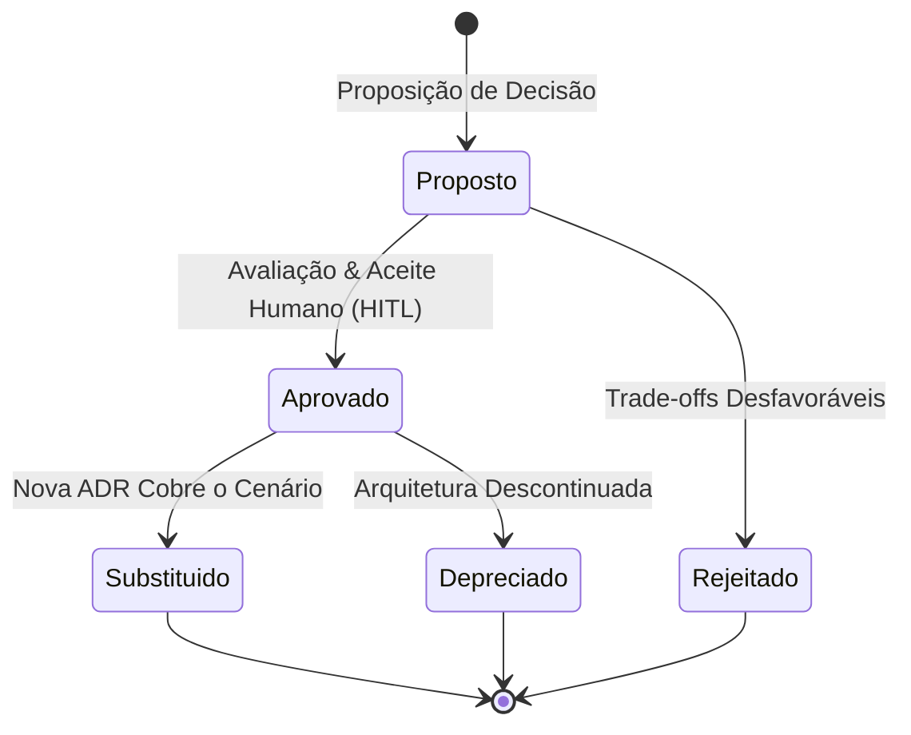

# 🏛️ Registros de Decisão Arquitetural (ADRs) — Meta-Hub

> **Arquitetura Docs-as-Code, Decisões Estruturais e Rastreabilidade do Ecossistema**  
> Repositório: [`heviane/heviane`](https://github.com/heviane/heviane) &bull; Diretório: `meta-hub/adrs`  
> Responsável: [Heviane Bastos](https://github.com/heviane) &bull; Status: `3 ADRs Vigentes` 🟢

---

## 📌 1. Visão Geral

Este diretório abriga os **Registros de Decisão Arquitetural** (*Architecture Decision Records* — **ADRs**) do ecossistema `@heviane`.

No paradigma **Docs-as-Code** e na arquitetura **AI-SEP** (*AI-Assisted Software Engineering Platform*), decisões arquiteturais não são memórias tácitas ou registros dispersos em ferramentas externas: elas constituem código vivo de governança, versionadas no Git e diretamente vinculadas ao ciclo de vida de desenvolvimento (SDLC).

Cada ADR documenta uma decisão arquitetural significativa, seu contexto, as forças determinantes ponderadas, a decisão formal tomada e as consequências operacionais (ganhos, trade-offs e mitigações de riscos).

---

## 🧭 2. Catálogo de Decisões Vigentes

| ID | Título da Decisão | Status | Data | Impacto & Escopo |
| :---: | :--- | :---: | :---: | :--- |
| **[ADR-0001](./0001-sdd-and-ai-governance-adoption.md)** | Adoção de Spec-Driven Development (SDD) e Governança de IA no SDLC | `Aprovado` | 2026-10-31 | Governança de IA, contratos operacionais (`AGENTS.md`), especificações prévias e Human-in-the-Loop. |
| **[ADR-0002](./0002-sensitive-data-segregation-multi-root-workspaces.md)** | Segregação Física de Dados Sensíveis e Governança Local em Nuvem via Multi-Root Workspaces | `Aprovado` | 2026-11-20 | Isolamento físico de certificados A1 e segredos de clientes fora do Git, integrando unidades em nuvem e `.code-workspace`. |
| **[ADR-0003](./0003-ai-sep-platform-architecture.md)** | Formalização da Plataforma de Engenharia de Software Assistida por IA (AI-SEP) | `Aprovado` | 2026-11-21 | Formalização da arquitetura integrada em camadas do ecossistema para desenvolvimento autônomo com rigor técnico. |

---

## 📐 3. Ciclo de Vida e Estados de uma ADR

As decisões arquiteturais atravessam estados formais durante sua vigência:

- **`Proposto`:** Em fase de discussão, redação e análise de forças com a pessoa desenvolvedora.
- **`Aprovado`:** Decisão aceita, vigente e de conformidade obrigatória por humanos e agentes de IA.
- **`Substituído`:** Decisão superseded por uma ADR posterior (com indicação cruzada bidirecional obrigatória).
- **`Depreciado`:** Padrão descontinuado sem substituição direta.
- **`Rejeitado`:** Proposta avaliada e não adotada (mantida no histórico para preservar o racional técnico).

---

## 📝 4. Convenção de Nomenclatura e Estrutura Canônica

1. **Nome de Arquivo:** Formato estrito `NNNN-kebab-case-title.md`, com padding de 4 dígitos numéricos sequenciais (ex.: `0004-nova-decisao-tecnica.md`).
2. **Template Base:** Utilizar o modelo oficial padronizado em [`docs/templates/ADR.md`](https://github.com/heviane/project-starter-kit/blob/main/docs/templates/ADR.md) do `project-starter-kit`.
3. **Seções Obrigatórias:**
   - **Cabeçalho & Metadados:** Status, Data, Decisores, Contexto Técnico.
   - **1. Contexto e Forças do Problema:** Motivação objetiva e forças conflitantes analisadas.
   - **2. Decisão Tomada:** Ação arquitetural escolhida e pilares estruturais.
   - **3. Consequências:** Ganhos positivos, trade-offs/custos e controles de riscos adotados.
   - **4. Alternativas Consideradas:** Tabela comparativa detalhando opções descartadas e motivos técnicos da rejeição.
4. **Zero Host Secrets:** Proibição absoluta de inclusão de credenciais, segredos, senhas ou caminhos físicos com letras de unidade do host local (`E:\`, `H:\`, etc.), utilizando marcadores conceituais (`<workspace-root>`, `<secure-vault>`, `<governance-cloud>`).

---

## 🔗 5. Navegação & Interconexão Documental (Graph Interconnection)

- 🏛️ **[Meta-Hub README](../README.md):** Visão geral de governança, arquitetura e matriz de saúde.
- 📋 **[Backlog Mestre (`backlog.md`)](../backlog.md):** Itens de roadmap, melhorias arquiteturais e iniciativas.
- 🤖 **[Diretrizes de Agentes (`AGENTS.md`)](../../AGENTS.md):** Regras de ouro universais e contratos de pair programming.
- 🧪 **[Suíte de Testes Pester (`tests/`)](../tests/README.md):** Validação automatizada de integridade das automações.
- 🛠️ **[Automações PowerShell (`scripts/`)](../scripts/README.md):** Scripts de auditoria, sincronização e reconciliação.
