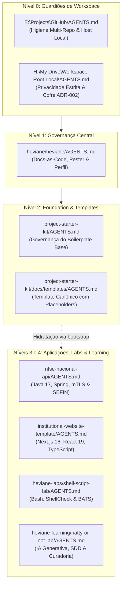

# 🤖 Catálogo Canônico de Contratos de IA & Matriz de Paridade (`agents-catalog.md`)

> **Inventário Oficial de Diretrizes de Agentes de IA do Ecossistema (Docs-as-Code)**  
> **Data de Atualização:** 24/11/2026 | **Total de Contratos Auditados:** 9 ativos  
> **Central de Governança:** [Meta-Hub (`meta-hub`)](./README.md) | **Segregação:** [ADR-002](./adrs/002-segregacao-dados-sensiveis-multi-root-workspaces.md) | **Arquitetura AI-SEP:** [ADR-003](./adrs/003-formalizacao-arquitetura-ai-sep.md)  
> *Nota: Este documento cataloga todos os arquivos `AGENTS.md` existentes no ecossistema, descrevendo suas especificidades de domínio, stacks tecnológicas e matriz comparativa de paridade com as 15 Regras de Ouro Universais.*

---

## 📑 Sumário

- [Visão Geral & Taxonomia dos Contratos de IA](#-1-visão-geral--taxonomia-dos-contratos-de-ia)
- [Checklist & Inventário Descritivo dos Agentes](#-2-checklist--inventário-descritivo-dos-agentes)
  - [Nível 0: Guardiões de Workspace Global](#nível-0-guardiões-de-workspace-global)
  - [Nível 1: Meta-Hub & Perfil Principal](#nível-1-meta-hub--perfil-principal)
  - [Nível 2: Repositório-Matriz & Template Base](#nível-2-repositório-matriz--template-base)
  - [Nível 3: Soluções Core em Produção & Templates Web](#nível-3-soluções-core-em-produção--templates-web)
  - [Nível 4: Laboratórios Técnicos & Aprendizado](#nível-4-laboratórios-técnicos--aprendizado)
- [Matriz de Paridade das Regras de Ouro (Feature Matrix)](#-3-matriz-de-paridade-das-regras-de-ouro-feature-matrix)
- [Procedimento Operacional de Propagação de Novas Regras](#-4-procedimento-operacional-de-propagação-de-novas-regras)
- [Grafo de Rastreabilidade](#-5-grafo-de-rastreabilidade)

---

## 🎯 1. Visão Geral & Taxonomia dos Contratos de IA

Os contratos operacionais de inteligência artificial (`AGENTS.md`) definem a postura, restrições arquiteturais, padrões de qualidade e convenções de commit que qualquer modelo ou agente autônomo (Antigravity, GitHub Copilot, Claude Code, Cursor, Windsurf) deve obedecer ao atuar no ecossistema `@heviane`.

Para garantir escalabilidade e impedir o ***drift* metodológico** (divergência ou desatualização silenciosa de regras), os contratos são organizados em uma taxonomia hierárquica de **4 Níveis Estratégicos**:

---

## 📋 2. Checklist & Inventário Descritivo dos Agentes

Checklist operacional consolidado de todos os 9 contratos vigentes no ecossistema:

### Nível 0: Guardiões de Workspace Global

#### 1. Guardião Global do Host Local (`E:\Projects\GitHub\AGENTS.md`)

- [x] **Status:** Ativo & Operacional
- **Localização:** [`E:\Projects\GitHub\AGENTS.md`](file:///E:/Projects/GitHub/AGENTS.md)
- **Escopo / Papel:** Guardião transversal do ambiente de desenvolvimento local cobrindo todos os repositórios públicos clonados no host Windows.
- **Stack / Ambiente:** Multi-stack (Java, .NET, Node, Python, PowerShell, Shell Script).
- **Propósito & Especificidades:**
  - Evitar contaminação cruzada entre repositórios vizinhos.
  - Exigir que qualquer comando `git` seja restrito cirurgicamente ao subdiretório do repositório alvo (`git -C <repo>`).
  - Proibir absolutamente a criação de commits ou pushes a partir da raiz agregadora do workspace.
  - Blindagem de segredos locais (`.env*`, certificados `.pfx`/`.p12`).

#### 2. Guardião do Cofre em Nuvem (`H:\My Drive\Workspace Root Local\AGENTS.md`)

- [x] **Status:** Ativo & Operacional
- **Localização:** [`H:\My Drive\Workspace Root Local\AGENTS.md`](file:///H:/My%20Drive/Workspace%20Root%20Local/AGENTS.md)
- **Escopo / Papel:** Guardião de privacidade e integridade do cofre em nuvem privado corporativo, em total conformidade com a [ADR-002](./adrs/002-segregacao-dados-sensiveis-multi-root-workspaces.md).
- **Stack / Ambiente:** Markdown, Obsidian, Google Drive, Arquivos de Carreira & Auditoria.
- **Propósito & Especificidades:**
  - Segregação física rígida: proíbe agentes em projetos públicos de acessarem ou referenciarem dados desta unidade.
  - Governança dos bastidores: dossiês vivos (`reviews/`), notas de carreira, rascunhos estratégicos e logs de inteligência competitiva.
  - Protocolo estrito de *Zero Leaks*: proibição absoluta de sincronização com repositórios Git públicos sem sanitização prévia.

---

### Nível 1: Meta-Hub & Perfil Principal

#### 3. Meta-Hub Central & Perfil Executivo (`heviane/heviane/AGENTS.md`)

- [x] **Status:** Ativo & Operacional
- **Localização:** [`heviane/heviane/AGENTS.md`](file:///E:/Projects/GitHub/heviane/heviane/AGENTS.md)
- **Escopo / Papel:** Repositório central de governança Docs-as-Code e vitrine pública curricular da engenheira no GitHub.
- **Stack / Ambiente:** PowerShell 5.1/7+, GitHub Actions, GitHub CLI (`gh`), Pester 3/5, markdownlint.
- **Propósito & Especificidades:**
  - **Higiene e Ergonomia do Perfil:** Manutenção visual clean do `README.md` público, sem poluição de badges ou seções prolixas.
  - **Automações PowerShell:** Garantia contínua de 100% de aprovação na suíte de testes Pester (`meta-hub/tests/scripts.Tests.ps1` — 22/22 cenários verdes).
  - **Sincronização Cloud Contínua:** Reconciliação mandatória do `backlog.md` com o GitHub Project 14 via `sync-project-backlog.ps1`.
  - **Auditoria Contínua de PRs & Dependências:** Monitoramento ativo via `gh pr list` e incorporação via Squash Merge de atualizações automatizadas seguras com CI verde.
  - **Multi-Shell Interoperability:** Proibição do operador `&&` no terminal Windows em favor do padrão seguro `; if ($?) { ... }`.
  - **Encoding Rigoroso:** Scripts `.ps1` com acentos/emojis obrigatoriamente salvos com UTF-8 BOM (`0xEF, 0xBB, 0xBF`).

---

### Nível 2: Repositório-Matriz & Template Base

#### 4. Repositório-Matriz do Starter Kit (`project-starter-kit/AGENTS.md`)

- [x] **Status:** Ativo & Operacional
- **Localização:** [`project-starter-kit/AGENTS.md`](file:///E:/Projects/GitHub/heviane/project-starter-kit/AGENTS.md)
- **Escopo / Papel:** Governança do repositório-fábrica oficial do ecossistema, responsável por fornecer o boilerplate para todos os novos projetos.
- **Stack / Ambiente:** Shell Script (Bash/PowerShell), GitHub Actions, Gitleaks, markdownlint, Templates SDD.
- **Propósito & Especificidades:**
  - Garantia de qualidade do ecossistema de templates (`docs/templates/`).
  - Preservação da integridade dos scripts de bootstrap interativo (`bootstrap.ps1`, `bootstrap.sh`) e autolimpeza pós-hidratação.
  - Rigor extremo contra regressões em pipelines de CI (Gitleaks, lint de Markdown e verificação de licença).
  - **Auditoria de PRs & Dependências Seguras:** Governança de PRs automatizados via `gh pr list` e integração via Squash Merge mantendo a integridade dos templates e do CI.
  - Referência para o Playbook de Engenharia de IA e Guia de Segurança & Guardrails (`docs/guia-seguranca-agentes-ia.md`).

#### 5. Template Canônico Padrão-Ouro (`project-starter-kit/docs/templates/AGENTS.md`)

- [x] **Status:** Ativo & Operacional
- **Localização:** [`project-starter-kit/docs/templates/AGENTS.md`](file:///E:/Projects/GitHub/heviane/project-starter-kit/docs/templates/AGENTS.md)
- **Escopo / Papel:** Modelo semente canônico em duas camadas copiado e hidratado automaticamente ao instanciar novos repositórios.
- **Stack / Ambiente:** Multi-stack desacoplada (seção de domínio plugável).
- **Propósito & Especificidades:**
  - Estrutura em duas partes: Camada Universal (15 Regras de Ouro imutáveis) e Camada de Domínio customizável.
  - Marcadores Canônicos Contratuais: Padronização estrita no formato `[UPPER_SNAKE_CASE]` (ex.: `[NOME_DO_PROJETO]`, `[DESCRICAO_DO_PROJETO]`, `[TECNOLOGIAS_UTILIZADAS]`).
  - Tolerância zero a placeholders órfãos: scripts de bootstrap devem hidratar 100% dos marcadores.

---

### Nível 3: Soluções Core em Produção & Templates Web

#### 6. Middleware Fiscal NFS-e Nacional (`nfse-nacional-api/AGENTS.md`)

- [x] **Status:** Ativo & Operacional
- **Localização:** [`nfse-nacional-api/AGENTS.md`](file:///E:/Projects/GitHub/heviane/nfse-nacional-api/AGENTS.md)
- **Escopo / Papel:** Middleware corporativo de missão crítica para emissão, consulta e cancelamento de Notas Fiscais de Serviço eletrônicas (NFS-e Nacional).
- **Stack / Ambiente:** Java 17, Spring Boot 3, Apache CXF (SOAP), GeneXus 18 ACL, mTLS (RFC 5246), XML RSA-SHA256, Maven.
- **Propósito & Especificidades:**
  - **Conformidade Fiscal Absoluta:** Validação estrita de contratos XML contra Schemas XSD v1.00 oficiais do Comitê Gestor da NFS-e (SEFIN).
  - **Segurança Criptográfica:** Uso de mTLS com certificados A1 (`.pfx`) manipulados exclusivamente em memória segura, nunca gravados em disco nem expostos em logs.
  - **Anti-Corruption Layer (ACL):** Camada de adaptação para consumo por ERPs legados e GeneXus via SOAP sem necessidade de certificados locais nos clientes.
  - **Testes Determinísticos:** Mocks offline para validações fiscais sem disparar requisições contra ambientes de produção da Receita Federal.

#### 7. Boilerplate Corporativo Web Institucional (`institutional-website-template/AGENTS.md`)

- [x] **Status:** Ativo & Operacional
- **Localização:** [`institutional-website-template/AGENTS.md`](file:///E:/Projects/GitHub/heviane/institutional-website-template/AGENTS.md)
- **Escopo / Papel:** Boilerplate web corporativo de alta performance e acessibilidade para entregas rápidas de sites institucionais para clientes.
- **Stack / Ambiente:** Next.js 16 (App Router), React 19, TypeScript 5, Tailwind CSS v4, Vitest, Playwright.
- **Propósito & Especificidades:**
  - **Web Vitals Críticos:** Código otimizado para metas rigorosas de UX (LCP < 2.5s, CLS < 0.1, FID/INP excelente).
  - **Acessibilidade & Inclusão:** Conformidade obrigatória com padrões WCAG 2.1 nível AA e semântica HTML5 estrita.
  - **LGPD by Design:** Gestão modular de consentimento de cookies e políticas de privacidade integradas.
  - **Zero Regressão Visual:** Validações de layout responsivo (Mobile First) e tipagem TypeScript sem uso de `any`.

---

### Nível 4: Laboratórios Técnicos & Aprendizado

#### 8. Laboratório de Infraestrutura CLI & Shell (`heviane-labs/shell-script-lab/AGENTS.md`)

- [x] **Status:** Ativo & Operacional
- **Localização:** [`heviane-labs/shell-script-lab/AGENTS.md`](file:///E:/Projects/GitHub/heviane-labs/shell-script-lab/AGENTS.md)
- **Escopo / Papel:** Laboratório de automações de linha de comando, utilitários Linux e engenharia de scripts portáveis.
- **Stack / Ambiente:** Bash 5+, POSIX Shell, ShellCheck, BATS (Bash Automated Testing System).
- **Propósito & Especificidades:**
  - **Análise Estática Rigorosa:** Todos os scripts `.sh` devem passar com zero warnings no ShellCheck (`shellcheck -x`).
  - **Portabilidade POSIX / Bash:** Verificação explícita de compatibilidade entre distribuições Linux e ambientes WSL.
  - **Testes Unitários de CLI:** Cobertura de cenários de sucesso, modo silencioso, tratamento de erros e códigos de saída via BATS.

#### 9. Laboratório de IA Generativa & SDD (`heviane-learning/natty-or-not-lab/AGENTS.md`)

- [x] **Status:** Ativo & Operacional
- **Localização:** [`heviane-learning/natty-or-not-lab/AGENTS.md`](file:///E:/Projects/GitHub/heviane-learning/natty-or-not-lab/AGENTS.md)
- **Escopo / Papel:** Laboratório prático da trilha DIO focado em experimentação de IA generativa, curadoria de mídia sintética e aplicação de Spec-Driven Development na calibração de prompts.
- **Stack / Ambiente:** Markdown, Engenharia de Prompts, LLMs, Spec-Driven Development.
- **Propósito & Especificidades:**
  - **SDD para IA:** Ciclo formal onde cada prompt é precedido por uma especificação técnica (`specs/`) com Critérios de Aceite objetivos.
  - **Rastreabilidade de Interações:** Registro versionado de prompts calibrados, parâmetros de temperatura/top-p e saídas brutas para comparação de modelos.
  - **Ética & Transparência:** Rotulagem explícita de todo conteúdo sintético gerado por IA conforme boas práticas de IA responsável.

---

## ⚖️ 3. Matriz de Paridade das Regras de Ouro (Feature Matrix)

Esta matriz cruza cada contrato com as **15 Regras de Ouro Universais** consolidadas no ecossistema, permitindo identificar o nível de conformidade e planejar atualizações direcionadas:

| Regra de Ouro Universal | Host Global | Cloud Vault | Meta-Hub | Starter Kit | Template Base | NFS-e API | Website Template | Shell Lab | Natty Lab |
| :--- | :---: | :---: | :---: | :---: | :---: | :---: | :---: | :---: | :---: |
| **R1: Human-in-the-Loop (Aprovação)** | ✅ | ✅ | ✅ | ✅ | ✅ | ✅ | ✅ | ✅ | ✅ |
| **R2: Anti-Lazy Code (Completo)** | ✅ | ✅ | ✅ | ✅ | ✅ | ✅ | ✅ | ✅ | ✅ |
| **R3: Minimal Diff (Cirúrgico)** | ✅ | ✅ | ✅ | ✅ | ✅ | ✅ | ✅ | ✅ | ✅ |
| **R4: Conclusão por Evidências** | ✅ | ✅ | ✅ | ✅ | ✅ | ✅ | ✅ | ✅ | ✅ |
| **R5: Parcimônia de Dependências** | ✅ | ✅ | ✅ | ✅ | ✅ | ✅ | ✅ | ✅ | ✅ |
| **R6: Zero Secrets (Segurança)** | ✅ | ✅ | ✅ | ✅ | ✅ | ✅ | ✅ | ✅ | ✅ |
| **R7: Docs no Ciclo do Commit** | ✅ | ✅ | ✅ | ✅ | ✅ | ✅ | ✅ | ✅ | ✅ |
| **R8: Preservação Defensiva** | ✅ | ✅ | ✅ | ✅ | ✅ | ✅ | ✅ | ✅ | ✅ |
| **R9: Integridade & UTF-8 BOM** | ✅ | ✅ | ✅ | ✅ | ✅ | ✅ | ✅ | ✅ | ✅ |
| **R10: Heurística de README** | ✅ | ✅ | ✅ | ✅ | ✅ | ✅ | ✅ | ✅ | ✅ |
| **R11: Living Dossier Monotemático** | ✅ | ✅ | ✅ | ✅ | ✅ | ✅ | ✅ | ✅ | ✅ |
| **R12: Sandbox Hygiene** | ✅ | ✅ | ✅ | ✅ | ✅ | ✅ | ✅ | ✅ | ✅ |
| **R13: Safe CLI Chaining (No `&&`)** | ✅ | ✅ | ✅ | ✅ | ✅ | ✅ | ✅ | ✅ | ✅ |
| **R14: Graph Interconnection** | ✅ | ✅ | ✅ | ✅ | ✅ | ✅ | ✅ | ✅ | ✅ |
| **R15: Marcadores Canônicos** | ✅ | ✅ | ✅ | ✅ | ✅ | ✅ | ✅ | ✅ | ✅ |

### Legenda da Matriz:

- ✅ **Conformidade Total (100% dos Contratos Alinhados):** Regra explicitamente formalizada, versionada e auditada no contrato. Todos os 9 contratos vigentes possuem paridade contratual integral.

---

## 🔄 4. Procedimento Operacional de Propagação de Novas Regras

Sempre que a engenharia decidir formalizar ou aprimorar uma diretriz operacional para agentes de IA:

1. **Incubação & Validação:**
   - A regra é formulada, debatida e testada primeiramente no Meta-Hub (`heviane/heviane/AGENTS.md`) e no cofre de auditoria (`reviews/`).
2. **Institucionalização no Starter Kit:**
   - Se for uma regra universal permanente, integra-se ao `project-starter-kit/AGENTS.md` e ao seu modelo canônico `project-starter-kit/docs/templates/AGENTS.md`.
3. **Consulta à Matriz de Paridade (`agents-catalog.md`):**
   - Utiliza-se a seção 3 deste documento para selecionar os repositórios-alvo que demandam a nova diretriz (ex.: regra de infraestrutura afeta apenas o Shell Lab; regra de segurança fiscal afeta a NFS-e API).
4. **Aplicação Cirúrgica & Commit Atômico:**
   - Atualiza-se o contrato de cada repositório selecionado em commits atômicos padronizados:  
     `docs(agents): propagate Rule X (<nome-da-regra>) to operational guidelines`
5. **Atualização da Matriz:**
   - Atualiza-se o checklist e a matriz deste catálogo no mesmo ciclo de entrega.

---

## 🔗 5. Grafo de Rastreabilidade

- 🏛️ **Central de Governança:** [`meta-hub/README.md`](./README.md)
- 📚 **Catálogo de Repositórios:** [`meta-hub/repository-catalog.md`](./repository-catalog.md)
- 📌 **Backlog Mestre:** [`meta-hub/backlog.md`](./backlog.md) (Item `GOV-11`)
- 🏛️ **Quadro Executivo:** [Project 14 (GitHub Projects)](https://github.com/users/heviane/projects/14)
- 🛡️ **Guia de Segurança de Agentes:** [`docs/guia-seguranca-agentes-ia.md`](https://github.com/heviane/project-starter-kit/blob/main/docs/guia-seguranca-agentes-ia.md)
