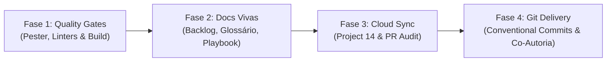

# 🛠️ Guia de Convenções de Manutenção e Governança

> **Manual Operacional e Diretrizes de Engenharia para o Ecossistema Multi-Repositórios (Docs-as-Code)**  
> **Central de Governança:** [Meta-Hub (`meta-hub`)](./README.md) | **Última Revisão:** 25/11/2026  

---

## 📑 Sumário

- [1. Padrão de Mensagens de Commit (Conventional Commits)](#1-padrão-de-mensagens-de-commit-conventional-commits)
- [2. Ciclo de Vida e Registro de Decisões Arquiteturais (ADRs)](#2-ciclo-de-vida-e-registro-de-decisões-arquiteturais-adrs)
- [3. Gestão de Backlog e Demandas (Docs-as-Code vs. GitHub Projects)](#3-gestão-de-backlog-e-demandas-docs-as-code-vs-github-projects)
- [4. Revisão e Conciliação do Catálogo de Repositórios](#4-revisão-e-conciliação-do-catálogo-de-repositórios)
- [5. Atualização do Inventário de Extensões do VS Code](#5-atualização-do-inventário-de-extensões-do-vs-code)
- [6. Política de Obsolescência e Arquivamento de Repositórios](#6-política-de-obsolescência-e-arquivamento-de-repositórios)
- [7. Quality Gates Locais & Checklist Pós-Implementação (DoD)](#7-quality-gates-locais--checklist-pós-implementação-dod)

---

## 1. Padrão de Mensagens de Commit (Conventional Commits)

Todas as mensagens de commit devem seguir a especificação [Conventional Commits](https://www.conventionalcommits.org/), garantindo histórico semântico limpo e auditável:

```text
<tipo>(<escopo opcional>): <descrição no imperativo e em minúsculas>
```

### Tipos Permitidos

| Tipo | Finalidade e Contexto de Uso |
| :--- | :--- |
| **`docs`** | Alterações exclusivas em documentação (`README.md`, `ADRs`, `backlog.md`, etc.). |
| **`feat`** | Nova funcionalidade, script ou recurso adicionado ao repositório. |
| **`fix`** | Correção de bugs, falhas em scripts ou erros de links e sintaxe. |
| **`refactor`**| Refatoração de código ou documentação sem alteração de comportamento público. |
| **`test`** | Adição ou aprimoramento de testes automatizados (Pester, linters, etc.). |
| **`chore`** | Tarefas de manutenção rotineira, dependências ou configurações de ferramentas. |
| **`ci`** | Alterações nos fluxos do GitHub Actions (`.github/workflows/`). |

### Exemplos Práticos

```bash
docs(profile): modernize readme to software engineer positioning
test(scripts): expand pester test suite with path validation
ci(workflows): add weekly dependabot schedule for github actions
```

---

## 2. Ciclo de Vida e Registro de Decisões Arquiteturais (ADRs)

Decisões que impactam arquitetura, padrões tecnológicos, segurança ou metodologias devem ser registradas como **Architectural Decision Records (ADR)** no diretório [`meta-hub/adrs/`](./adrs/).

### Nomenclatura e Numeração

Os arquivos seguem o padrão sequencial de três dígitos:

```text
meta-hub/adrs/NNN-titulo-resumido-em-kebab-case.md
```

### Estrutura Obrigatória da ADR

1. **Título e Metadados:** Número, Título, Data, Autor, Status (`🟡 Proposto`, `🟢 Aceito`, `🔴 Rejeitado`, `⚪ Obsoleto`).
2. **Contexto & Problema:** A motivação técnica e as restrições identificadas.
3. **Decisão Arquitetural:** A solução escolhida detalhada tecnicamente.
4. **Consequências & Trade-offs:** Prós, contras e riscos assumidos.
5. **Critérios de Validação:** Como a decisão é auditada e garantida.

---

## 3. Gestão de Backlog e Demandas (Docs-as-Code vs. GitHub Projects)

O ecossistema adota a governança em **Flight Levels**:

1. **Ideação Local (`meta-hub/backlog.md`):**  
   Novas ideias, estudos e fatias de evolução técnica nascem documentadas no backlog sob Docs-as-Code.
2. **Priorização Estratégica (Flight Level 3):**  
   Demandas que entram em execução são sincronizadas como Issues vinculadas ao projeto:  
   👉 **[GitHub Project #14 (AI Engineering Hub)](https://github.com/users/heviane/projects/14)**.

   Para manter a paridade automatizada entre o `backlog.md` e o Project 14:

   ```powershell
   # Auditar divergências entre o Markdown e o GitHub Projects
   powershell -ExecutionPolicy Bypass -File meta-hub/scripts/sync-project-backlog.ps1 -CheckOnly

   # Sincronizar status e prioridades
   powershell -ExecutionPolicy Bypass -File meta-hub/scripts/sync-project-backlog.ps1 -SyncStatus -SyncPriority
   ```

3. **Conclusão:**  
   Ao concluir a demanda, atualiza-se o status no GitHub Projects para `Done` e o item no `backlog.md` para `🟢 [Concluído]`, acompanhado do hash do commit de entrega.

---

## 4. Revisão e Conciliação do Catálogo de Repositórios

O [`repository-catalog.md`](./repository-catalog.md) reflete os repositórios públicos das três organizações oficiais (`@heviane`, `@heviane-labs`, `@heviane-learning`).

### Rotina Periódica de Conciliação (GitHub CLI)

Para validar a conformidade e identificar repositórios recém-criados ou renomeados:

```powershell
# Executar a cada release ou mensalmente
@('heviane', 'heviane-labs', 'heviane-learning') | ForEach-Object {
    gh repo list $_ --visibility=public --json name,isArchived,pushedAt
}
```

### Passos de Atualização

1. Caso um novo repositório seja criado, classifique-o na tabela correspondente da organização.
2. Atribua o nível de maturidade objetivo (Nível 1, 2 ou 3) com base na rubrica.
3. Atualize o total de repositórios no cabeçalho do catálogo e sincronize o número no `meta-hub/README.md` e no `README.md` raiz.

---

## 5. Atualização do Inventário de Extensões do VS Code

O arquivo [`vscode-extensions.md`](./vscode-extensions.md) documenta todas as extensões do ambiente de desenvolvimento padronizado.

### Como Atualizar

Sempre que novas extensões forem instaladas ou atualizadas no VS Code:

```powershell
# Executa a partir da raiz do repositório
.\meta-hub\scripts\sync-extensions.ps1
```

### Validação sem Gravação (Modo CI/Linter)

```powershell
.\meta-hub\scripts\sync-extensions.ps1 -CheckOnly
```

---

## 6. Política de Obsolescência e Arquivamento de Repositórios

Para manter a vitrine técnica relevante e sem código legado fantasma:

1. **Critérios de Arquivamento:**
   - Repositório acadêmico ou de PoC inativo há mais de 24 meses sem commits.
   - Dependências legadas com vulnerabilidades críticas não remediáveis.
   - Ferramentas substituídas por novas arquiteturas (ex: scripts legados migrados para SDD).
2. **Procedimento de Arquivamento:**
   - Arquivar o repositório no GitHub (`gh repo archive <owner>/<repo>`).
   - Atualizar o status no `repository-catalog.md` para `⚪ Arquivado`.
   - Incluir nota no topo do `README.md` do repositório arquivado apontando para a solução sucessora.

---

## 7. Quality Gates Locais & Checklist Pós-Implementação (DoD)

Antes de considerar qualquer entrega finalizada ou realizar `git push origin main`, execute o **Protocolo Compulsório de 4 Fases** formalizado em [`docs/post-implementation-checklist.md`](https://github.com/heviane/project-starter-kit/blob/main/docs/post-implementation-checklist.md) no repositório de templates:



### 7.1. Validação Local Pré-Commit no Meta-Hub

No repositório central (`heviane/heviane`), os quality gates automatizados são executados no PowerShell:

```powershell
# 1. Validação de formatação Markdown
npx --yes markdownlint-cli2 "**/*.md"

# 2. Execução da suíte completa de testes Pester (22 cenários verdes)
Invoke-Pester -Path "meta-hub/tests/scripts.Tests.ps1"

# 3. Auditoria estrutural do workspace multi-repositórios
powershell -ExecutionPolicy Bypass -File .\meta-hub\scripts\audit-workspace.ps1 -StrictGovernance

# 4. Sincronização contínua com o GitHub Project 14
powershell -ExecutionPolicy Bypass -File .\meta-hub\scripts\sync-project-backlog.ps1 -SyncStatus -SyncPriority
```

Se todos os checks passarem sem avisos (`0 issues`, `22 passed`, `0 divergências`), o incremento satisfaz a *Definition of Done (DoD)* do ecossistema e o pipeline do GitHub Actions passará 100% verde.
